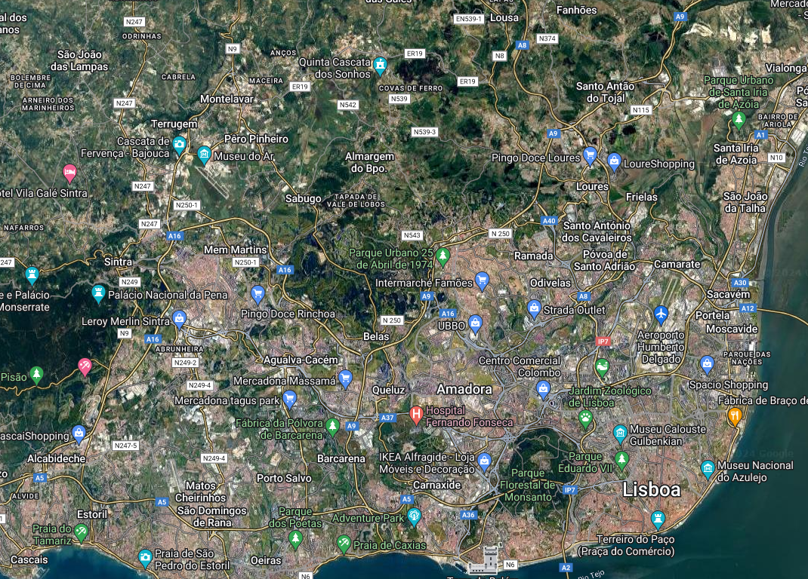

<div align="center">



# Lisboa+Perto 🏙️🇵🇹

**Plataforma de gestão urbana que aproxima os cidadãos da Câmara Municipal de Lisboa**


</div>

---

## 📋 Informações

| | |
|---|---|
| **👥 Autores** | Pedro Rosa ([@pedrorosa3](https://github.com/pedrorosa3)), Tiago Raposo e Tomás Nogueira |
| **📅 Data de entrega** | 24 de maio de 2024 (ano letivo 2023/2024) |
| **🎓 Unidade curricular** | Aplicações e Serviços na Web (ASW) |
| **🏛️ Instituição** | Faculdade de Ciências da Universidade de Lisboa (FCUL) |
| **🔄 Última atualização do README** | 13 de novembro de 2026 |

---

## 📖 Sobre o projeto

O **Lisboa+Perto** é uma aplicação web que permite aos cidadãos **reportar problemas urbanos** — buracos na estrada, candeeiros avariados, acumulação de lixo, etc. — e que dá aos funcionários da **Câmara Municipal de Lisboa (CML)** um *back-office* para gerir, priorizar e resolver essas ocorrências.

## ✨ Funcionalidades

### 🌍 Visitantes e cidadãos
- **Registo e login** de utilizadores.
- **Reportar ocorrências** com categoria, subcategoria, descrição, fotografia e localização marcada num **mapa** (Leaflet + OpenStreetMap).
- **Pesquisa** de ocorrências por rua, localidade, categoria ou estado.
- **Acompanhamento do estado** de cada ocorrência (Por Resolver → A ser Resolvido → Resolvido).
- **Chat** com os funcionários da CML sobre uma ocorrência específica.
- **Feedback** sobre as ocorrências, com avaliação de 1 a 5.

### 🏛️ Funcionários da CML (*back-office*)
- **Painel de gestão** para ver, filtrar e alterar o estado das ocorrências.
- **Edição de ocorrências** e registo do histórico de mudanças de estado.
- **Comunicação com os cidadãos** através do chat.

## 🛠️ Tecnologias

| Camada | Tecnologia |
|---|---|
| Frontend | HTML5, CSS3, JavaScript, Bootstrap 5 |
| Mapas | Leaflet + OpenStreetMap |
| Backend | PHP (extensão `mysqli`) |
| Base de dados | MySQL / MariaDB |
| Infraestrutura | Docker, Docker Compose |

## 📁 Estrutura do projeto

```
Lisboa-Perto/
├── index.php                 # Página inicial (visitantes)
├── registo.php / login.php   # Registo e autenticação
├── home.php                  # Área do cidadão
├── registarocorrencia2.php   # Reportar ocorrência (com mapa)
├── pesquisaocorrencia.php    # Pesquisa de ocorrências
├── chat.php                  # Chat cidadão ↔ CML
├── feedback.php              # Feedback das ocorrências
├── cml.php / cmlpesquisa.php # Back-office da CML
├── editocorrencia.php        # Edição de ocorrências
├── abreconexao.php           # Ligação à BD (variáveis de ambiente ou .env)
├── .env.example              # Modelo das variáveis de ambiente
├── BDASW18.sql               # Esquema da base de dados
├── Dockerfile                # Imagem PHP + Apache
├── docker-compose.yml        # App + MySQL + phpMyAdmin
├── docker/                   # Dados iniciais (seed.sql) e php.ini
├── uploads/                  # Fotografias das ocorrências
└── relatorio-3etapa.pdf      # Relatório final do projeto
```

## 🚀 Como executar

Há duas formas de correr o projeto: com **Docker** (recomendado, não precisa de configurar nada) ou com um servidor local como o **XAMPP**.

### 🐳 Opção A — Docker (recomendado)

**Pré-requisito:** [Docker Desktop](https://www.docker.com/products/docker-desktop/) instalado e a correr.

Na pasta do projeto, executa:

```bash
docker compose up -d --build
```

Isto cria três contentores:

| Serviço | Endereço | Descrição |
|---|---|---|
| **App** | <http://localhost:8080> | A aplicação Lisboa+Perto (PHP 8.2 + Apache) |
| **phpMyAdmin** | <http://localhost:8081> | Gestão da base de dados |
| **MySQL** | `db:3306` (interno) | Base de dados criada automaticamente |

Na primeira execução, a base de dados é criada a partir do [`BDASW18.sql`](BDASW18.sql) e preenchida com os dados iniciais de [`docker/seed.sql`](docker/seed.sql): estados, categorias, subcategorias de exemplo e um utilizador da CML para o *back-office*:

| Email | Password | Tipo |
|---|---|---|
| `cml@lisboaperto.pt` | `admin123` | Funcionário CML |

Para criar uma conta de cidadão, usa a página **Registar**.

Comandos úteis:

```bash
docker compose logs -f app   # ver os logs da aplicação
docker compose down          # parar os contentores
docker compose down -v       # parar e apagar a base de dados (é recriada no próximo "up")
```

### 🖥️ Opção B — XAMPP / WAMP / LAMP

#### 1. Pré-requisitos
- Um servidor local com **Apache, PHP 7.0 ou superior e MySQL/MariaDB**, por exemplo [XAMPP](https://www.apachefriends.org/), WAMP ou LAMP.

#### 2. Copiar o projeto
Clona o repositório para a pasta pública do servidor (`htdocs` no XAMPP, `www` no WAMP):

```bash
cd C:/xampp/htdocs
git clone https://github.com/pedrorosa3/Lisboa-Perto.git
```

#### 3. Criar a base de dados
1. Inicia o **Apache** e o **MySQL** no painel do XAMPP.
2. Abre o phpMyAdmin em <http://localhost/phpmyadmin> e cria uma base de dados (ex.: `lisboaperto`).
3. Seleciona essa base de dados e importa o ficheiro [`BDASW18.sql`](BDASW18.sql) (separador **Importar**).
4. Importa também o [`docker/seed.sql`](docker/seed.sql) para ter estados, categorias e o utilizador da CML.

#### 4. Configurar a ligação
As credenciais da base de dados ficam num ficheiro `.env`, que não é enviado para o git. Copia o modelo:

```bash
cp .env.example .env
```

E preenche-o com os dados do teu servidor local:

```env
DB_HOST=localhost
DB_USER=root
DB_PASS=
DB_NAME=lisboaperto
```

#### 5. Abrir no browser
Acede a:

```
http://localhost/Lisboa-Perto/index.php
```

## 🗂️ Etapas de desenvolvimento

1. **Etapa 1** — Design da interface, funcionalidades para visitantes e modelação da base de dados.
2. **Etapa 2** — Autenticação (login/logout), gestão de estados e lógica do *back-office*.
3. **Etapa 3** — Funcionalidades assíncronas (chat), integração do mapa e relatório final.

---

<div align="center">

Projeto desenvolvido para fins académicos · FCUL · 2023/2024

</div>
